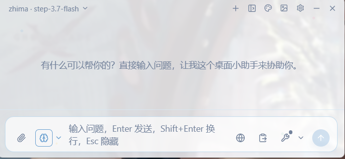
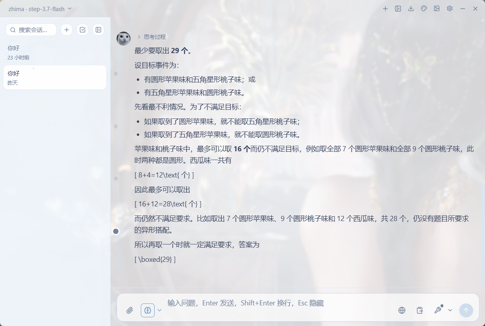
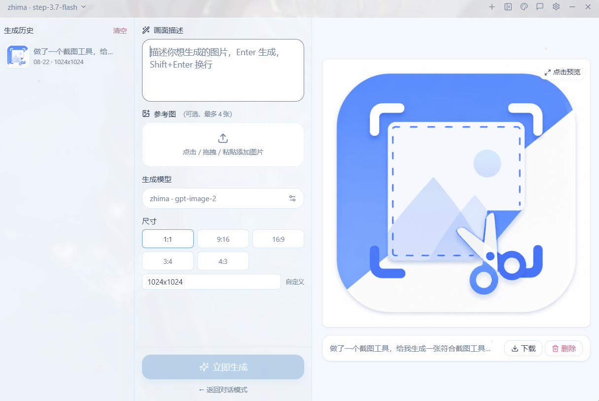
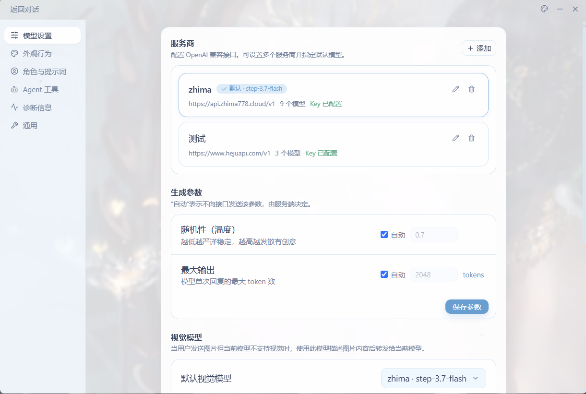
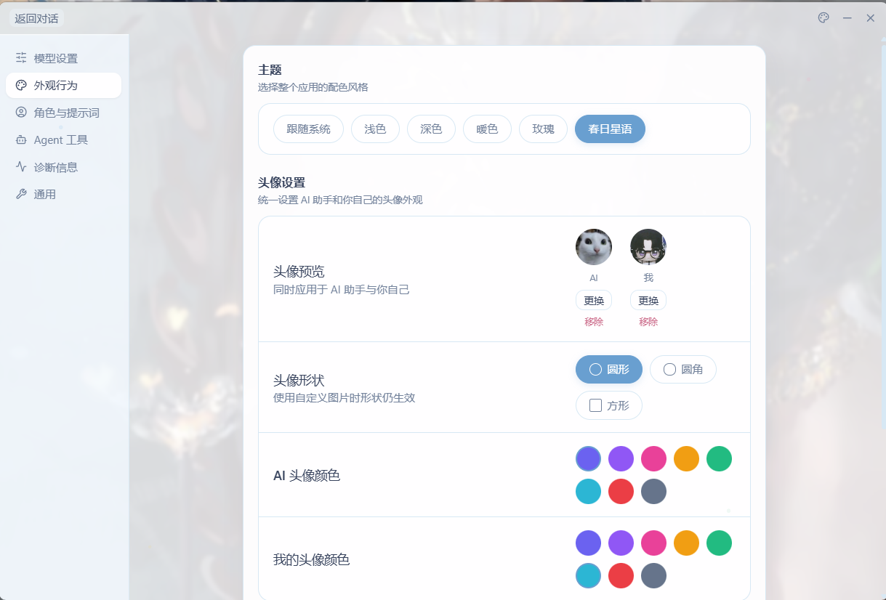
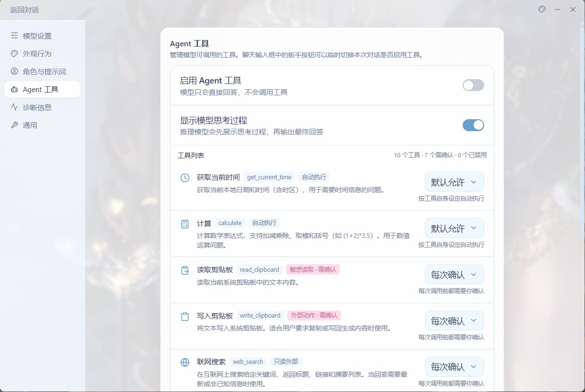
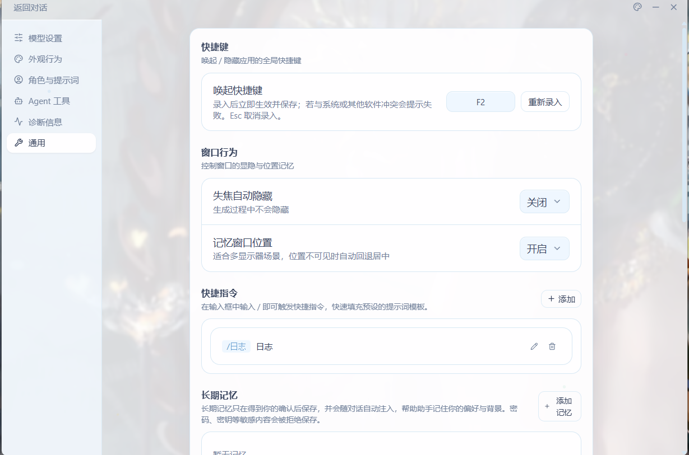

# Zhima · 芝麻 — 桌面悬浮窗 AI 助手

> 一个常驻桌面的 AI 助手：`Alt+Space` 唤出，问完即走；选中文字按 `Alt+Q`，直接翻译/解释/总结。
> Windows · 安装包约 **6.4 MB** · 数据全在本地 · 可接任何 Chat Completions 兼容模型（含国产模型与本地 Ollama）

---

## 一、这是什么

芝麻不是「又一个聊天客户端」，而是把 AI 塞进**当前工作流**的一层：

- 它在你要用的时候出现（一个快捷键），不用的时候消失（失焦自动隐藏），**不需要切换到浏览器、也不需要打开一个大窗口**；
- 它不绑定厂商：任何 Chat Completions 兼容接口都能接 —— 国产模型、中转 API、自建服务、本地 Ollama 一视同仁；
- 它把数据留在本机：会话、记忆、知识库、技能、生成的图片都在本地 SQLite，API Key 在 Windows 凭据管理器。

一句话概括：**Cherry Studio 那类客户端的「日常问答 + 工具 + 知识库」能力，压进一个 6.4 MB、随唤随到的悬浮窗里。**

### 它和常见方案的区别

| 对比对象 | 它的不同 |
|---|---|
| ChatGPT / 各家网页版 | 不用切窗口、不用登录第三方；模型自选；历史不出本机 |
| Electron 类桌面客户端（Cherry Studio 等） | 体积 6.4 MB ↔ 100 MB+；专注「问答 + 工具」而非小程序/笔记/频道等全功能套件 |
| 系统助手（Copilot 等） | 不绑定单一厂商，可换成任意模型或本地模型 |
| IDE / 编辑器插件 | 不限于某个编辑器：任何程序里选中的文字都能取词（划词助手） |

## 二、典型使用场景

| 场景 | 怎么用 |
|---|---|
| 写代码卡住 | 复制报错 → `Alt+Space` → 粘贴提问；或选中报错直接 `Alt+Q` → 「解释」 |
| 读英文资料 | 选中段落 → `Alt+Q` → 「翻译」（回答可一键写回剪贴板，直接替换原文） |
| 看懂一份文档 | 输入框 📎 附加 Word / Excel / PPT / PDF / 文本 → 「总结要点」 |
| 资料反复要用 | 把文档/网页/笔记导入**知识库**，提问时自动检索；点击回答旁的「检索参考资料」核对本次上下文片段 |
| 想知道哪个模型答得好 | 勾选 2 个以上模型 → **一问多答**，分栏对照 |
| 需要外部能力 | 接入 **MCP** 工具服务器（官方 filesystem / fetch 等），让模型真正读写文件、访问网页 |
| 找旧对话 | 侧栏搜索框输入关键词 → 直接搜**消息正文**（支持中文），点击命中直达该条消息 |
| 讲清一个流程 | 直接说「画个流程图 / 时序图 / 架构图」→ 图表在对话内直接渲染，可全屏缩放、导出 SVG / PNG |
| 有固定套路 | 把格式要求（周报模板 / 代码评审规范 / 文案风格）写成**技能**，命中关键词自动照做 |
| 同时跑几件事 | 一个对话生成中可切走另开对话继续提问，后台并行输出，侧栏显示「生成中 / 已完成」 |

## 三、核心概念

- **服务商 / 模型**：一个服务商 = 一个 Chat Completions 兼容接口（Base URL + API Key）。常用厂商（DeepSeek / 智谱 / MiniMax / Kimi / 通义 / 硅基流动 / 火山方舟 / OpenAI / OpenRouter / 本地 Ollama）可一键预设；模型可拉取、收藏、设默认；另可单独指定视觉模型与兜底模型。
- **悬浮窗 vs 完整模式**：`Alt+Space` 是快问快答的悬浮窗；点标题栏展开为完整模式，出现历史侧栏、全文搜索、多模型对比、轮次索引、多对话并行。
- **助手（Assistant）**：把「角色提示词 + 指定模型 + 工具策略」存成一个助手，会话绑定它 —— 相当于可切换的专家人格。
- **技能（Skill）**：把「有固定套路的做法」写成技能：常驻的只有名称与描述，命中触发词（或在输入框手动激活）才注入完整说明 —— 不白占上下文。设置 → 技能里管理，支持导入 `SKILL.md` / JSON / ZIP。
- **Agent 工具与授权**：模型可调用 12 个内置工具（搜索、抓取网页、读写剪贴板、读文件/PDF/文档、检索知识库、截屏、计算、时间、打开资源）。敏感工具**执行前询问**，可选「仅这一次 / 本次会话 / 永久允许」；一旦运行过本地敏感工具，后续联网工具会再次确认（防数据外流）。
- **MCP 工具服务器**：接入任意 stdio MCP 服务器，其工具自动出现在工具列表，默认每次调用都需确认。
- **知识库**：导入文档/网页/文本 → 本地分块入库 → 提问时按相关度（BM25）检索并注入上下文，附「检索测试」面板可先验证召回。
- **长期记忆**：值得记住的偏好由你确认后保存，按使用频率自动注入；密码类内容拒绝保存。
- **划词助手**：任意程序中选中文本按 `Alt+Q`，自动取词并唤起窗口，给出翻译 / 解释 / 总结 / 润色 / 起草回复。

## 四、能力清单

### 💬 对话与模型
- **随唤随到**：`Alt+Space` 全局唤起 / 隐藏，失焦自动隐藏（可关闭），位置记忆
- **多服务商多模型**：任意 Chat Completions 兼容接口 + 常用厂商一键预设
- **消息编辑与重新生成**：提问可编辑并重跑该轮回答；回答可原地重新生成，用 `‹ n/m ›` 在历史版本间切换，旧答案不丢
- **一问多答**：多模型并行提问、分栏对照、逐列停止
- **助手（Assistant）**：角色 + 模型 + 工具策略可保存复用
- **对话级模型**：每个对话绑定自己的模型，选择器就在输入框工具栏
- **多对话并行**：生成中可切换 / 新建对话，后台继续输出，侧栏显示「生成中 / 已完成」状态
- **会话文字草稿**：各会话独立保留未发送文字，切换会话或设置后恢复；仅保存在本次运行内存中，不跨重启保存。图片和文档附件不随草稿保存，导入备份开始时清空旧草稿
- **流式对话**：Rust 直连 + 健壮 SSE 解析（粘包 / 拆包 / UTF-8 跨块），思考过程展示与等级选择（低 / 中 / 高 / 最大）
- **会话管理**：置顶 / 重命名 / 批量删除 / 轮次索引跳转
- **跨会话全文搜索**：中文可搜的消息级搜索，点击直达

### 🔍 检索与知识
- **联网搜索多引擎**：DuckDuckGo（默认免 Key）/ Tavily / 博查 / SearXNG，设置内切换，密钥进凭据管理器；反爬验证自动识别并给出明确提示，各引擎附免费额度与注册引导
- **网页抓取**：带 SSRF 防护的正文读取，结果以来源卡片展示
- **本地知识库**：Word / Excel / PPT / PDF / 网页 / 文本入库，BM25 检索 + 自动注入 + 检索测试
- **检索证据面板**：点击「检索参考资料」按编号查看本次请求准备的上下文片段、标题和来源，可复制片段或手动打开安全网页来源。是否发送以请求状态为准，面板不代表服务商已收到或回答已引用。片段可能包含检索高亮和省略标记，不等同于完整原文；快照仅存内存，重新从数据库加载后不补造历史证据，正文 `[资料N]` 暂不是跳转链接
- **长期记忆**：用户确认式保存，频率注入，敏感内容拒绝
- **本轮上下文预览**：输入框「上下文」查看候选记忆、知识片段、技能、摘要、历史裁剪及粗略预算，可仅本轮排除指定记忆或知识文档。预览不联网、不调用视觉模型、不增加记忆使用次数；发送时会重新解析，输入/附件/模型变化后需刷新，联网和工具后续内容不在静态预览内

### 📎 输入与输出
- **文档附件**：输入框 📎 统一入口读 docx / xlsx / pptx / pdf / 文本与图片，正文并入本次提问，历史保留徽标；文件可直接拖进窗口
- **多文件分析**：快捷操作中的文件汇总、比较、任务提取等入口直接提取正文，不再只发送路径。最多 8 份文档、同时解析 2 份、正文合计 60,000 个 JavaScript 字符单位（附件标记另计）；逐项展示进度、错误、截断及正文预览，解析完成前不能发送。切换会话或离开聊天页后附件需重新添加
- **图表绘制**：说「画个流程图」即可 —— mermaid 图表在对话内渲染（流程图 / 时序图 / 状态图 / 类图 / ER 图 / 甘特图 / 饼图等），4 种风格（跟随主题 / 科技蓝 / 莫兰迪 / 手绘风），复杂图自动切换 ELK 布局，支持全屏缩放预览与 SVG / PNG 导出
- **图片输入**：粘贴 / 选择图片交给视觉模型
- **文生图工作台**：文生图 + 参考图生图，参数面板 + 画布 + 历史
- **公式渲染**：`$...$` 与 `$$...$$`（KaTeX，命中公式才按需加载）
- **导出**：Markdown / PNG 图片 / 打印另存为 PDF（长对话自动展开后导出）
- **数据备份**：v2 备份覆盖会话/消息、记忆、技能、生成图片、助手及绑定、知识库/分块、摘要与待办，支持旧版导入、合并和替换；白名单非敏感配置可在资料导入后单独确认恢复（**不含 API Key、代理认证、MCP 启动配置、自动授权、头像/背景文件**）
- **本地恢复点**：设置 → 数据与存储可手动创建和预览恢复点；替换资料前必须成功创建自动恢复点，失败则不替换。保留最近 5 个，每份上限 256 MiB。自动恢复点不含前端 UI 偏好，手动恢复点可包含；资料、服务商配置与 UI 偏好分阶段恢复，不承诺跨文件原子回滚

### 🛠 工具与自动化
- **Agent 工具系统**：12 个内置工具 + 三级授权 + 数据流防泄漏，调用时间线可视化
- **自定义技能**：常用套路写成技能（设置 → 技能），命中触发词自动生效，也可在输入框手动激活（本对话内保持）；支持导入 `SKILL.md` / JSON / ZIP，随数据备份迁移
- **MCP 接入**：stdio MCP 服务器，工具自动发现、默认需确认
- **划词助手**：`Alt+Q` 取词后文字**直接进入输入框**（已有草稿则追加），另提供翻译 / 解释 / 总结 / 润色 / 起草回复动作，回答通过复制按钮显式写入剪贴板
- **自定义桌面动作**：设置 → 上下文与记忆中配置划词/剪贴板来源、`{{input}}` 模板、助手、技能和输出提示；支持排序、收藏及示例。动作先填入草稿，再由用户确认发送；不自动联网、不自动覆盖剪贴板或原应用文本
- **本地待办**：回答动作栏可确认保存待办，设置 → 待办与提醒可编辑、完成、删除及回到来源消息。Rust 在应用运行/托盘驻留时每 15 秒检查到期项，通过显示应用窗口和应用内卡片提醒（不是 Windows 系统通知）；退出后不提醒，重启补查未确认到期项

### 🎨 界面与系统
- 6 套主题（系统 / 浅色 / 深色 / 暖色 / 玫瑰 / 春日）、自定义头像与背景
- 悬浮窗 ↔ 完整模式一键切换，呼出与页面切换带水浮现动效
- **模型用量统计**：累计 / 峰值 token、最长聊天时长、连续天数、一年活动热力图（每日 / 每周 / 累计）、每模型趋势折线与占比环形图
- 系统托盘、单实例、自动更新（Ed25519 签名校验）、HTTP / SOCKS5 代理

## 五、为什么这么轻

| 维度 | 实现方式 |
|---|---|
| 6.4 MB 安装包 | Tauri 2 + 系统 WebView2，**不打包 Chromium** |
| 小内存 / 快响应 | 网络请求、SSE 解析、工具执行、文档解析全在 Rust 侧 |
| 首屏不拖慢 | 代码高亮、KaTeX、设置面板、mermaid 图表引擎（含 ELK 布局）等按需分块加载 |
| 零外部依赖 | 检索用 SQLite FTS5 / BM25，**不引向量模型**；docx / xlsx / pptx 解析自行实现，新增依赖仅 `zip`（GBK 解码复用 reqwest 已有的 `encoding_rs`） |

## 六、适合谁

**适合**：日常频繁问 AI 的人（写代码、写文档、看资料）；用国产模型 / 中转 / 自建 API 的人；在意「历史不出本机」的人；喜欢键盘流（`Alt+Space` / `Alt+Q`）的人。

**不适合**：需要 macOS / Linux / 手机版；需要向量检索的重型知识库；需要笔记、小程序、IM 机器人等全功能套件；需要团队协作与云端同步。

## 🛠 技术栈

| 层 | 技术 |
|---|---|
| 前端 | React 18 · TypeScript · Vite · Tailwind CSS · Zustand · react-virtuoso · KaTeX · mermaid（ELK 布局） |
| 后端 | Rust · Tauri 2 · reqwest · rusqlite (SQLite，含 FTS5) · keyring · zip / pdf-extract |
| 关键机制 | SSE 流式解析 · FTS5 trigram 中文检索 · BM25 知识库 · MCP JSON-RPC · SendInput 取词 |
| 动画 | react-spring（窗口"水浮现"入场 / 页面切换过渡） |

## 📁 目录结构

```text
src/                        React + TypeScript 前端
  app/                      入口组件
  components/               composer / conversation / history / markdown / model-picker / window-shell
  features/settings/        设置面板（模型 / 外观 / 角色 / 工具 / 技能 / 用量 / 诊断 / 通用）
  features/imagegen/        文生图工作台
  lib/                      导出（Markdown / PNG / 图表）、打印、附件块、窗口与动效工具 · mermaid 渲染主题
  services/                 流式事件桥接 + providers / history / assistants / skills / backup / knowledge / mcp API
  stores/                   Zustand：chat / providers / settings / window / assistants / imagegen
  styles/                   设计令牌与全局样式（含打印样式）
src-tauri/src/              Rust / Tauri 后端
  agent/                    上下文预算 · 滚动摘要 · 长期记忆 · 知识库分块与提示词 · 技能注入
  api/                      OpenAI 适配器 · SSE 解析 · 联网搜索多引擎 · 安全 HTTP 抓取
  commands/                 chat / history / providers / assistants / skills / backup / knowledge / mcp / settings …
  mcp/                      MCP stdio 客户端（JSON-RPC + 会话池）
  storage/                  providers.json 配置 · keyring 密钥 · SQLite 会话库/待办（迁移 v1→v23）
  tools/                    工具注册表 · 12 个内置工具 · 文档解析（docx/xlsx/pptx/pdf/文本）
  window/                   窗口管理 · 全局快捷键 · 托盘 · 划词取词
  models/                   请求 / 响应 / 配置数据结构
scripts/                    图标生成与发布脚本（release-update.mjs）
```

## 🚀 开发

前置：Node.js ≥ 18、Rust（stable-msvc）、Windows MSVC 构建工具。

```bash
npm install
npm run tauri:dev
```

## 📦 构建与发布

```bash
npm run tauri:build                 # 仅构建安装包
node scripts/release-update.mjs     # 构建 + minisign 签名 + 生成 latest.json
```

安装包（NSIS）输出到 `src-tauri/target/release/bundle/nsis/`，发布产物汇总到 `release/updates/`。
脚本支持通过环境变量自动部署到静态服务器（暂存 → 大小校验 → 原子替换），详见脚本头部注释。

GitHub Release：先打 tag 并推送（`git tag -a v2.5.0 -m "…" && git push origin v2.5.0`），
再执行 `node scripts/github-release.mjs` 创建 Release 并上传安装包与签名，说明自动取自
`release/release-notes.txt` 的对应版本段（该脚本为本地发布辅助脚本，不入库）。

GitHub Releases 页面：<https://github.com/MOONKEY0510/ZHIMA-agent/releases>

## 🧪 测试与检查

```bash
npm run check:frontend              # typecheck + vitest + vite build
npm run check:rust                  # fmt --check + clippy -D warnings + cargo test
npm run check                       # 两者一起跑
```

当前基线：Rust **286** 个测试通过（另有 1 个由测试显式启动的假 MCP 子进程入口标记为忽略），前端 **287** 个测试（29 个测试文件）全部通过；Windows CI 会在每次提交运行同样的检查。

## 🔒 隐私

所有对话历史（含图片）、记忆、知识库、助手与生成图片保存在本地 SQLite；API Key 存于 Windows 凭据管理器；
工具调用的参数与结果不写入数据库，历史中只保留调用时间线；一旦会话中出现本地敏感内容，联网或发送给模型前会再次确认。
除你配置的模型服务商、搜索接口和你自己的 MCP 服务器外，不请求任何第三方服务。
详见 [PRIVACY.md](./PRIVACY.md)。

## ⚠️ 已知限制

- 安装包未做 Windows 代码签名（未购置证书），首次运行可能触发 SmartScreen「未知发布者」提示
- 依赖系统 WebView2：目标机器缺失时安装包需要联网下载（不内置浏览器内核，这也是体积小的原因）
- 知识库为本地 BM25 关键词检索（**有意不引入向量模型**，保持零外部依赖）
- 划词取词对管理员权限（UAC 提升）窗口无效，这是 Windows 系统限制
- MCP 服务器以你的用户权限在本机运行，仅添加可信来源
- 备份为明文，不包含系统凭据、MCP 启动配置或头像/背景资源；同一服务商 ID 的地址变化或有残留密钥但无旧地址记录时，配置恢复会拒绝，需手动重新配置
- 待办提醒仅应用运行时有效，通过应用窗口呈现；无独立后台服务或系统通知，退出后须重新启动才能补查
- 仅提供 Windows 版本与中文界面

## 📸 界面预览















## ⭐ Star 趋势

[](https://star-history.com/#MOONKEY0510/ZHIMA-agent&Date)

如果芝麻对你有用，欢迎点个 Star ⭐
